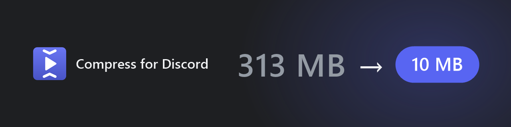
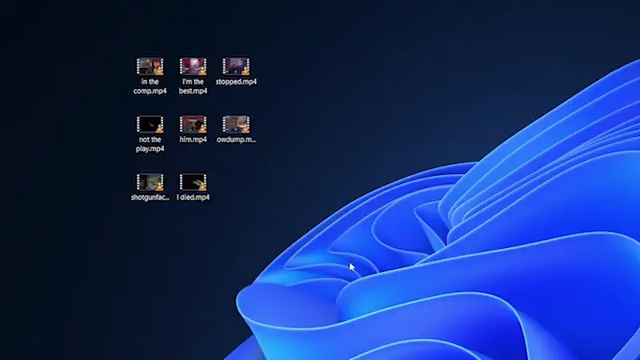

<p align="center"></p>

Right-click a video → **Compress for Discord**. Trim it, pick a size, press **Enter**, and paste it into Discord.

<p align="center"></p>

## Install

1. Download the `.msi` from [Releases](https://github.com/CalvBot/compress-for-discord/releases/latest) and run it. If SmartScreen warns (the installer isn't signed), click **More info → Run anyway**.
2. On first launch it offers to download ffmpeg, or you can point it at your own copy in **Settings**. Windows prompts for the .NET 9 Desktop Runtime if it's missing.

If you're on Windows 11 and don't see the option, it might be under **Show more options**.

## Building

Needs the [.NET 9 SDK](https://dotnet.microsoft.com/download/dotnet/9.0).

```powershell
.\build.ps1            # dist\CompressForDiscord-<version>.msi
.\build.ps1 -Install   # build and install it
```
